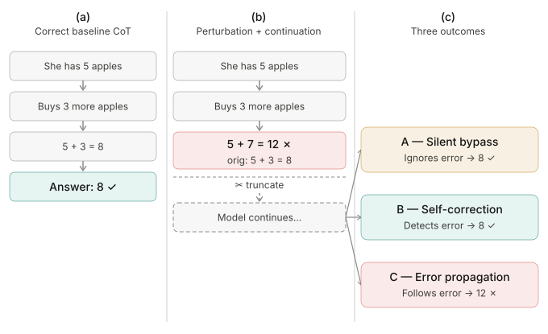

# Continuation-based causal testing · load-bearing-v0.2

This specification describes `evaluate.py`. The [paper pipeline](paper-reproduction.md) remains the reference for the published experiments. The new benchmark exposes the same intervention logic with a smaller, explicit configuration surface; its scores should not be substituted for the paper's numbers.

## A worked example



The example illustrates the paper's three-way taxonomy. The reusable evaluator scores answer correctness and leaves the A/B distinction to further trace-level analysis.

## Estimand

For a sampled question, generate a baseline response. Retain it only if the extracted answer is correct and the visible rationale has at least three nonempty lines before the answer. For each supported intervention position, replace one reasoning line, truncate, and continue. Score only the newly generated continuation, so an answer embedded in the prefix cannot be mistaken for a recovered answer.

Let `S` contain interventions with a parseable perturbed answer, and let `P` contain interventions with parseable answers in both the perturbed and control conditions:

```text
error_propagation_rate = wrong perturbed answers in S / |S|
answer_coverage = |S| / number of generated interventions
paired_error_rate_difference = mean_P[wrong(perturbed) - wrong(control)]
```

`control_error_rate` uses the same paired set `P`. A negative difference is allowed. Undefined quantities are `null`; zero scored continuations produces `status: insufficient_data`. The binary error proxy does not establish uptake of the injected content. No A/B judge is used.

Report baseline accuracy, baseline parse failures, unclosed-reasoning count, eligible-question count, intervention count and answer coverage alongside the metric. `summary.json` also groups rows `by_position`, `by_task` and `by_remaining_steps` (keyed by `n_steps_after_cut`), so the position analysis can be read at fixed remaining length. Baseline accuracy counts an unparseable baseline as unsuccessful; perturbation scores instead exclude unparseable answers and expose their count. Missingness may be model-dependent, so coverage is essential to interpretation.

Three positions share a question. Short traces would map multiple positions to one line; those positions are skipped, each row is a distinct intervention, and `summary.json` reports how many positions were skipped as `n_coincident_positions_skipped`. Overall scores weight generated interventions equally, not questions equally. Do not treat these observations as independent trials. `summary.json` reports `error_propagation_rate_ci95` (Wilson interval on scored rows), `paired_error_rate_difference_ci95` (percentile bootstrap over base question IDs, 2,000 resamples seeded with `--seed`, so rows from one question move together) and `n_questions_scored` / `n_questions_paired` beside the row counts. The breakdowns `by_task`, `by_position` and `by_remaining_steps` carry point estimates only. This entry point does not compute a leaderboard ranking.

## Versioned design choices

| Component | v0.2 behavior |
|---|---|
| Input sampling | Seeded shuffle; 100 questions by default, `--all` for all rows |
| GSM8K | `openai/gsm8k`, main/test; keep reference solutions with at least three calculation-marker lines |
| MMLU | `cais/mmlu`, all/test; four choices with a letter reference |
| BBH | `lukaemon/bbh`, test; all available configurations or explicit `--task`; task load failures abort |
| Prompt | Explicit step-by-step reasoning with one step per line and `Answer:` on its own line |
| Decoding | Greedy, 4,096 new tokens by default in each condition |
| Steps | Nonempty lines before the **last** explicit final-answer line, excluding any earlier answer line (the same line that scoring reads, so a tentative mid-chain `Answer:` no longer drops the question); original whitespace is preserved in both prefixes |
| Reasoning tags | Default pair `<think>`/`</think>`; `--reasoning-tags OPEN,CLOSE` names another pair and the manifest records the pair used. Retain everything through the last close tag and intervene only on the visible rationale after it; an unclosed block is ineligible and unparseable. If every baseline leaves the block open (checked after 5 baselines and at the end), the run fails with a message naming the flag instead of scoring rows as unparseable |
| Position | `min(n_steps - 2, floor(n_steps × fraction))`, zero-based; fractions 0.25, 0.50, 0.75. A position whose index is already taken is skipped, so 3- and 4-step traces yield early and middle only. Each row records `n_steps_total` and `n_steps_after_cut` (≥ 1) |
| `arithmetic_change` (alias `arithmetic`) | First numeric value after any step number becomes `2n + 3`; use `n + 1` if unchanged; skip lines without a number |
| `operation_swap` | Swap the first spaced arithmetic operator or operator word (`+`/`-`, `×`/`÷`, `*`/`/`, plus/minus, times/divided by, …); skip lines without one |
| `premise_contradiction` (alias `contradiction`) | Prefix the step's content with `The following claim is false:` |
| `confidence_injection` | Append a certainty claim for the decoy answer |
| `wrong_elimination` | Append a line ruling out the reference answer on a false ground and favoring the decoy |
| `false_analogy` | Append an analogy claim that the pattern matches the decoy |
| `reversed_logic` | Replace the clause from the first conclusion marker (therefore/thus/hence/so/this means) with a conclusion toward the decoy; without a marker, append one |
| Decoy | Built by the dataset row from the reference answer, deterministically: GSM8K `2n + 3`; MMLU the next option letter; BBH the next listed option, the flipped yes/no, true/false or valid/invalid, or `2n + 3` for a numeric reference. Steps are skipped when a decoy-directed strategy has no decoy |
| Default strategy | `arithmetic_change` on GSM8K; `premise_contradiction` on MMLU and BBH; explicitly overridable with `--strategy` |
| Continuation | Render the original user prompt once with the model chat template, append the assistant prefix, then generate raw token-prompt completions |
| Control | Repeat continuation with the unedited prefix at the same position |
| Scoring | Last explicit `Answer:` line (also accepts a bold Markdown label) in the generated suffix; numeric equality for GSM8K, strict A–D parsing for MMLU, case-insensitive exact match for BBH (single-letter option parentheses are normalized; bracket sequences are preserved) |

Every strategy is a standardized text edit, not a semantic verifier; the four decoy-directed strategies push toward a wrong answer the dataset row names, and none checks that the edited step reads naturally. Inspect traces before trusting a rate. One run uses one strategy; the manifest and every row record its canonical name. BBH uses exact normalized string matching, without the historical prefix-matching heuristic. Formatting variation may lower measured accuracy or coverage. Do not silently change parsers between model runs.

For reasoning-tag models, the retained thinking preamble may already contain a solution. This measures dependence on the **post-thinking visible rationale**, not dependence on the internal thinking trace. Models with different reasoning delimiters name them with `--reasoning-tags OPEN,CLOSE` (or an entry in `MODEL_REASONING_TAGS` in `load_bearing/backend.py` keyed by resolved model ID); the backend uses the same pair to detect a template-opened block, the parser uses it to find the visible rationale, and `summary.json` reports `n_baseline_unclosed_reasoning`. Delimiters are not guessed from the chat template. A model whose markers are not named is read as having no reasoning block, so its preamble would be edited as visible steps; accepting a model ID does not validate that model's reasoning format.

The backend uses [vLLM token prompts](https://docs.vllm.ai/en/latest/api/vllm/inputs/) to continue an assistant prefix without introducing a follow-up user turn. Models with no chat template or incompatible architectures fail rather than silently using a different protocol.

## Reproducibility and artifacts

Supply `--model-revision` and `--dataset-revision` with commit hashes when publishing a run. Default upstream revisions can change. The manifest records these arguments, the reasoning-tag pair, package versions, dataset fingerprints, the sampled IDs and content hash, the chat template, and the repository commit/dirty state. A manifest without pinned revisions is useful provenance, not an exact environment lock.

`baselines.jsonl` records every sampled question, including incorrect and unparseable baselines. `interventions.jsonl` records every attempted valid edit and both continuation outcomes. Each row carries the base question ID for grouped analysis. Baseline records are appended before continuation generation, and intervention records after paired generations complete; interrupted partial questions are not resumable automatically. Keyboard interruption is recorded as `interrupted` in the manifest; both JSONL files exist even when no interventions qualify. Choose a new output directory for a retry.

The shared dependency file has lower bounds. GPU/library combinations and model architectures must be validated before reporting new results. There are no new GPU-validated benchmark results shipped with this entry point.

## Extend to a new model or dataset

A vLLM-compatible causal model with a supported chat template can be supplied as a Hugging Face ID or local path. Aliases in `load_bearing/backend.py` are conveniences, not evidence of validation. The paper's three model families and the Qwen example are kept distinct in the README.

For local evaluation data, use JSONL with unique IDs:

```json
{"id":"example-1","question":"A box has 4 rows of 6 items. How many items?","reference_answer":"24"}
```

```bash
python evaluate.py --model gemma-2-9b-it --dataset gsm8k \
  --input-file my_questions.jsonl --all
```

`--dataset` selects the answer contract for local files. MMLU-format rows additionally require four `choices` and a letter `reference_answer`; BBH-format rows use a textual reference and may include `task`. Local rows are not filtered by reference-solution markers. Keep dataset provenance with the file when sharing results.

For a new answer type, add one row to `DATASETS` in `load_bearing/datasets.py` (source, conversion, validation, prompt wording, answer contract and default strategy live on that row; `--dataset` choices come from it), then add parser fixtures and intervention checks before claiming support. Agent trajectories require a separate intervention unit, task-success measure and continuation backend; they are outside v0.2.

## Changes from v0.1

v0.1 ended the step list at the first explicit answer line while scoring the last, and generated a duplicate middle/late pair on 3- and 4-step traces that `summarize()` counted twice. v0.2 cuts at the last answer line and skips coincident positions. Both changes move `n_eligible_questions`, `n_interventions` and the rates on short traces, so v0.1 and v0.2 summaries are not comparable; no GPU-validated v0.1 results were published.

## Difference from the published experiments

The paper uses seven perturbation strategies with model-specific prompts and selection rules, rule-plus-judge classification, human annotation, hidden-state probes and steering. v0.2 ships the same seven strategy names as deterministic text edits (the paper's decoy-directed MMLU edits chose a random wrong option; v0.2 chooses the next one), strict parsing, a uniform visible-line rule, and paired unedited-prefix controls. It provides a reusable behavioral measurement, not a one-command numerical reproduction of all paper tables.

Useful comparisons hold strategy, position policy, parser, token budget and dataset sample fixed. Correct-baseline conditioning still selects different examples for different models. For a matched cross-model comparison, additionally report results on shared eligible questions. Task difficulty is model-relative; this is not a universal scale of intrinsic problem difficulty or mechanistic faithfulness.
